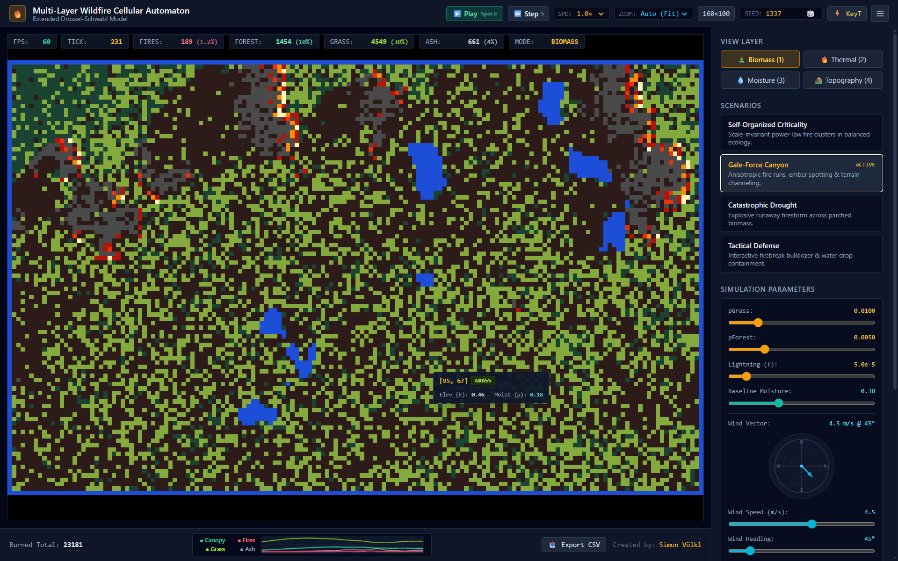
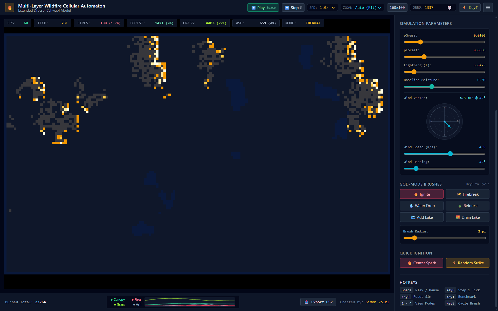
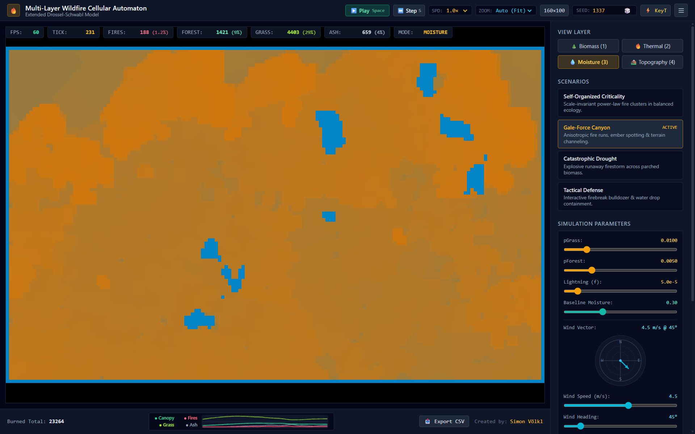
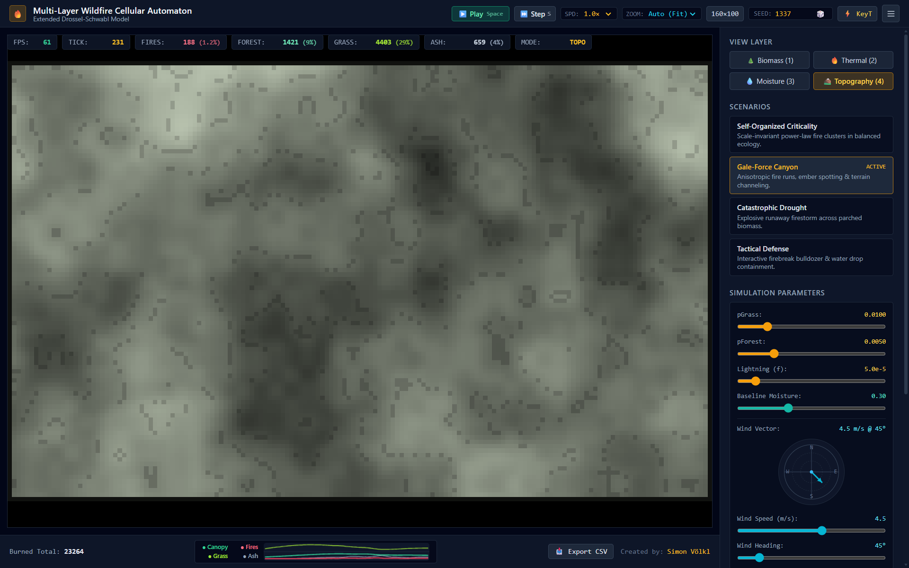
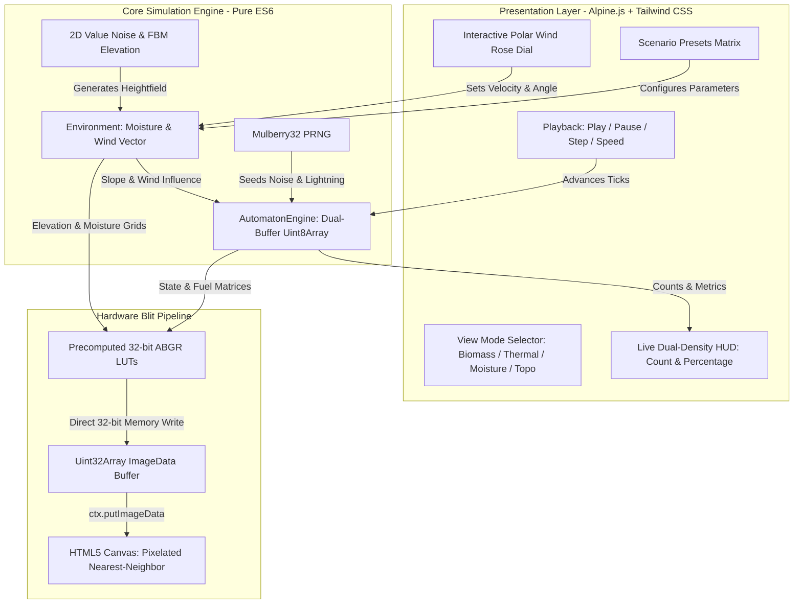
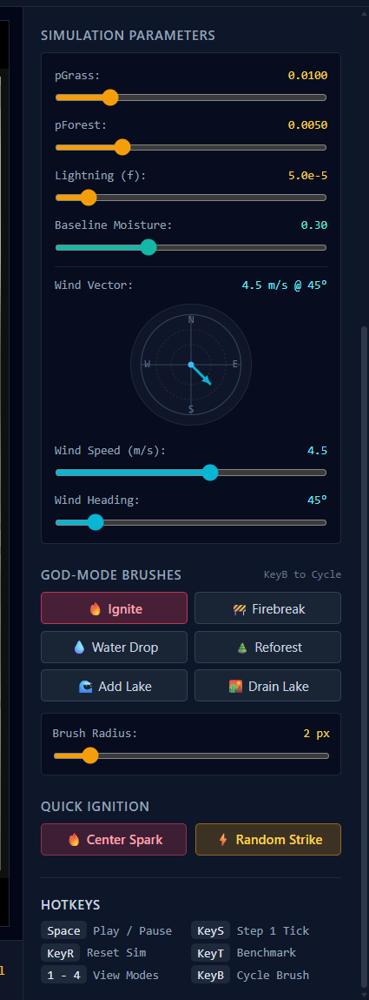

# Multi-Layer Wildfire Cellular Automaton

[](LICENSE)
[](index.html)
[](index.html)

A high-performance, client-side, zero-dependency wildfire simulation extending the **Drossel and Schwabl Forest-Fire Cellular Automaton**. It simulates non-linear ecological succession and anisotropic wildfire propagation across coupled discrete and continuous spatial matrices: vegetative biomass, fuel depletion countdowns, dynamic soil moisture diffusion, procedural elevation gradients, screen-space wind vectors, and downwind ember spotting.



**Demo Videos can be found here:** [Assets > Videos](./assets/videos)

---

## 🎮 What is this Simulation?

In classical physics and complex systems theory, the Drossel-Schwabl forest-fire model is a prototypical example of **Self-Organized Criticality (SOC)**: simple rules of continuous tree growth ($p$) and rare spontaneous lightning strikes ($f$) produce power-law distributions of wildfire cluster sizes.

This project takes that theoretical foundation and transforms it into an interactive **wildfire sandbox and tactical containment laboratory**:

- **Ecological Dynamics:** Pioneer grass swiftly recolonizes clearings, slowly maturing into dense forest canopy.
- **Physical Fire Fronts:** Burning cells consume finite fuel over multiple ticks, radiating heat and evaporating local moisture.
- **Topographic & Wind Channeling:** Fire surges rapidly uphill while downhill spread is subdued; high winds tilt flame fronts and launch long-distance airborne embers over natural firebreaks.
- **God-Mode Interactivity:** Act as an incident commander with interactive brushes to ignite test fronts, carve bulldozer firebreaks, drop aerial water retardant, create permanent lake reservoirs, drain existing water bodies, or reforest barren land.

---

## 1. System Overview

The application is an interactive, zero-dependency browser simulation designed for demonstration and data science analysis. It combines a direct 32-bit pixel-blitting HTML5 Canvas render pipeline with a reactive control dashboard (Alpine.js + Tailwind CSS) running completely client-side.

### Key Highlights

- **Zero-Build Architecture:** Runs directly via `file://` protocol or any static HTTP server with no compilation, bundlers, or NPM dependencies.
- **Direct 32-Bit Memory Blit:** Writes directly to `ImageData` via a precomputed `Uint32Array` Look-Up Table (LUT) in little-endian `0xAABBGGRR` byte order.
- **Unproxied Engine State:** Physics and TypedArrays reside outside Alpine.js reactive proxies to ensure 60+ FPS and 300+ TPS headless benchmarks.
- **Multi-Layer Physics:**
  - Dynamic moisture evaporation around fire fronts ($\delta_{\text{evap}} = 0.05$) and ambient recovery ($\delta_{\text{regen}} = 0.01$).
  - Slope-assisted fire propagation ($M_{\text{slope}} = \operatorname{clamp}(\exp(2.5 \cdot \nabla E), 0.1, 3.5)$).
  - Screen-space wind vectors ($M_{\text{wind}}$) and long-range ember spotting ($v \ge 2.5$).
  - 4-tier incandescent flame temperature ramp (Smoldering Crimson $\to$ Bright Red $\to$ Orange $\to$ White-Hot).
- **Consolidated Real-Time Telemetry:** Live rolling multi-curve sparkline tracking Canopy Biomass, Active Fires, Pioneer Grass, and Ash Cooldown in the footer strip.
- **Tactical God-Mode Toolkit:** 6 specialized brushes (`Ignite`, `Firebreak`, `Water Drop`, `Reforest`, `Add Lake`, `Drain Lake`) with adjustable radius ($1 \dots 10\text{ px}$).

### Map Types

Thermal Map:

Moisture Map:

Topography Map:


---

## 2. Architecture & Data Flow



---

## 3. Current Implementation Status

Implementation progress mapped against the Software Requirements Specification in [notes/plan.md](notes/plan.md):

### Phase 1: Scaffold, Seeded Noise & 32-Bit LUT Canvas Pipeline — ✅ Complete

- Mulberry32 PRNG and 2D FBM procedural value noise generator.
- Direct `ctx.putImageData` blitting via precomputed 32-bit ABGR Look-Up Tables.
- Sustains steady 60 FPS with zero memory allocation in render loops.

### Phase 2: Multi-State Dual-Buffer CA & Decoupled Playback Loop — ✅ Complete

- Double-buffered `currentGrid` & `nextGrid` (`Uint8Array`) with non-combustible absorbing boundaries.
- Dual-phase `fuelGrid` tracking active combustion countdown (1..4) and ash cooldown (1..8).
- Decoupled playback loop ($0.25\times, 0.5\times, 1.0\times, 2.0\times, 5.0\times, \text{Max}$) with `Space` and `KeyS` stepping.

### Phase 3: Physics Layers (Slope, Screen-Space Wind & Moisture) — ✅ Complete

- Continuous dynamic moisture field ($\mu \in [0.0, 1.0]$) with neighbor-density evaporative decay and ambient recovery.
- Normalized slope exponential multiplier ($k_s = 2.5$) accelerating uphill spread.
- Screen-space anisotropic wind vector model with directional dot-product influence and long-range ember spotting ($v \ge 2.5$).

### Phase 4: Presets Matrix, View Modes, HUD Overlays, Brushes & Hotkeys — ✅ Complete

- 4 calibrated demonstration scenarios (`SOC`, `GALE_FORCE_CANYON`, `CATASTROPHIC_DROUGHT`, `TACTICAL_DEFENSE`).
- 4 switchable layer modes (`Biomass`, `Thermal`, `Moisture`, `Topography`).
- Dual-density HUD formatting `[Count (Percentage%)]` for Active Fires, Forest, Grass, and Ash.
- Interactive polar SVG Wind Rose dial controller with direct pointer manipulation.
- Interactive God-Mode brushes (`Ignite`, `Firebreak Bulldozer`, `Aerial Water Drop`, `Reforest`, `Water Reservoir`) with variable radius ($1 \dots 10\text{ px}$) and hotkey cycling (`KeyB`).
- Sub-pixel DPI-aware canvas pointer re-projection and dynamic hover Cell Inspector HUD overlay.
- Responsive auto-zoom fit (`object-contain`) and blur-free nearest-neighbor pixelated canvas scaling.
- Vertically scrollable parameters sidebar (`h-screen overflow-hidden` parent layout containment).
- Stationary HUD card layout preventing jitter when value lengths shift.

### Phase 5: Telemetry Engine, Sparkline HUD & CSV Exporter — ✅ Complete

- Headless 1000-tick performance benchmark (`KeyT`) sustaining **300+ TPS**.
- Zero-allocation pre-allocated circular metric ring buffer (`MetricBuffer`, 50,000 capacity with automatic doubling expansion).
- Real-time rolling multi-curve sparkline trend canvas (Canopy Biomass, Active Fires, Pioneer Grass, Ash Cooldown).
- Full RFC 4180 CSV serializer & programmatic browser Blob downloader.

---

## 4. Quick Start & Execution

### Option A: Direct Browser Launch (Recommended)

Simply open `index.html` directly in any modern browser (Chrome, Edge, Firefox, Safari):

```bash
# Windows
start index.html

# macOS
open index.html

# Linux
xdg-open index.html
```

### Option B: Local Static Preview Server

Run a lightweight HTTP preview server:

```bash
python -m http.server 8000
# Navigate to http://localhost:8000
```

---

## 5. Controls & Hotkeys

| Action | Shortcut / Input | Description |
| :--- | :---: | :--- |
| **Play / Pause** | `Space` | Toggle automatic simulation tick advancement |
| **Step Tick** | `KeyS` | Step forward exactly 1 tick while paused |
| **Reset Simulation** | `KeyR` | Re-seed and re-generate world using active preset |
| **Cycle Brush** | `KeyB` | Cycle God-mode brush (Ignite $\to$ Firebreak $\to$ Water Drop $\to$ Reforest $\to$ Add Lake $\to$ Drain Lake) |
| **Benchmark** | `KeyT` | Run 1000 headless steps and display TPS performance |
| **View Modes** | `1` - `4` | `1`: Biomass, `2`: Thermal, `3`: Moisture, `4`: Topography |
| **Resolution Toggle** | Button | Switch between Standard ($160 \times 100$) and High-Res ($320 \times 200$) |
| **Wind Dial** | Click & Drag | Interactive polar dial to adjust wind heading and speed |
| **God-Mode Brushes** | Click & Drag | Paint on canvas to ignite, clear firebreaks, drop water, reforest, add lakes, or drain lakes |
| **Cell Inspector** | Hover | Real-time tooltip with coordinates, state, elevation, moisture & fuel |
| **CSV Telemetry Export** | Button | Download RFC 4180-compliant `.csv` dataset of the run |



---

## 6. Directory Structure

```text
ForestFireModel/
├── index.html                   # Zero-build distribution with hybrid UMD module loading
├── AGENTS.md                    # AI agent operating guidelines, constraints & code standards
├── README.md                    # Project documentation & status report
├── notes/
│   ├── plan.md                  # Comprehensive Software Requirements Specification (SRS)
│   └── abstract-plan-GER.md     # Original conceptual notes (German)
└── src/                         # Modular reference source architecture
    ├── config/
    │   ├── simConfig.js         # Physical constants, timers, grid dimensions
    │   ├── presetsConfig.js     # Curated scenario definitions
    │   └── renderConfig.js      # Color hexes, packed 32-bit ABGR, view modes
    ├── core/
    │   ├── PRNG.js              # Deterministic Mulberry32 PRNG
    │   ├── Noise2D.js           # 2D value noise & Fractal Brownian Motion (FBM)
    │   ├── Environment.js       # Topography heightfield, continuous moisture & wind
    │   └── AutomatonEngine.js   # Dual-buffer TypedArray engine & fire spread physics
    ├── render/
    │   ├── ColorPalettes.js     # Precomputed 32-bit ABGR LUTs & flame temperature ramps
    │   └── ViewportRenderer.js  # Direct Uint32Array ImageData blitter
    ├── telemetry/
    │   ├── MetricBuffer.js      # Zero-allocation ring buffer for high-frequency telemetry
    │   ├── SparklineRenderer.js # Rolling dual-curve sparkline mini-canvas
    │   └── CSVExporter.js       # RFC 4180 CSV serializer & Blob downloader
    ├── ui/
    │   ├── BrushController.js   # God-mode brush tools, radius controls & cycle switching
    │   └── DashboardBridge.js   # Alpine.js reactive root store & detached engine handles
    └── styles/
        └── custom.css           # Nearest-neighbor pixelated rules & custom dark scrollbar
```

---

## 7. License & Credits

- **Author:** Simon Völkl ([simonvoelkl.de](https://simonvoelkl.de))
- **License:** MIT License — see [LICENSE](LICENSE) for details.
