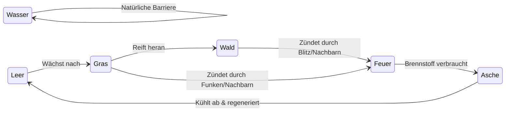
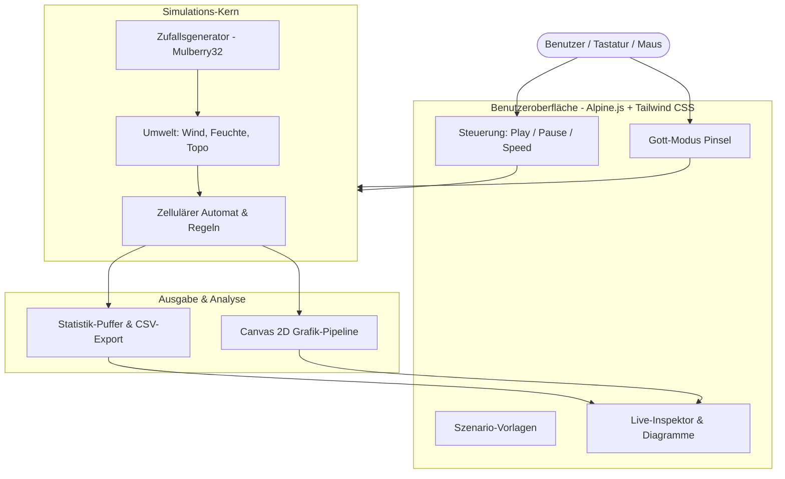

# Projektübersicht: Interaktiver 2D-Waldbrand-Simulator

Dieser Waldbrand-Simulator ist eine leichtgewichtige Web-Anwendung, die komplexe ökologische Brandausbreitungen direkt im Browser visualisiert.

Das Projekt basiert auf dem Prinzip eines **zellulären Automaten** (einer schachbrettartigen Matrix, in der jedes Feld nach festen Regeln mit seinen Nachbarn interagiert) und erweitert das klassische *Drossel-Schwabl-Modell* um realistische Umweltfaktoren wie **Wind, Geländeneigung und Bodenfeuchtigkeit**.

Das Besondere: Die gesamte Anwendung läuft ohne Installation, ohne Build-Tools (wie Webpack oder Vite) und ohne Server – **eine einzige `index.html`-Datei genügt**.

---

## 1. Wie die Simulation funktioniert

Das Spielfeld besteht aus einem Raster (z. B. $160 \times 100$ Zellen). Jede Zelle besitzt einen Zustand und entwickelt sich in Zeitschritten (*Ticks*) weiter.

### Der Lebenszyklus einer Zelle



* **Leer (Boden):** Trockener oder geräumter Boden, auf dem noch nichts brennt.
* **Gras (Pionierpflanze):** Wächst schnell nach, brennt aber in nur einem Tick blitzartig ab.
* **Wald (Dichte Vegetation):** Braucht Zeit zum Heranwachsen, speichert viel Brennstoff und brennt über mehrere Ticks hinweg mit hoher Hitze.
* **Feuer:** Zerstört Bewuchs, trocknet benachbarte Zellen aus und kann Nachbarzellen entzünden.
* **Asche:** Verbrannter Boden, der für einige Ticks abkühlen muss, bevor wieder etwas wachsen kann.
* **Wasser:** Dient als statische, nicht brennbare Barriere (Flüsse oder Seen).

---

## 2. Die Umweltfaktoren (Die Physik-Ebenen)

Damit sich das Feuer nicht wie ein einfacher Kreis ausbreitet, wirken mehrere Umgebungsebenen auf die Wahrscheinlichkeit ein, mit der ein Nachbarfeld Feuer fängt:

```
               [ Höhenunterschied ]
               (Bergauf brennt schneller)
                         │
                         ▼
[ Wind & Funkenflug ] ──► [ AUSBREITUNGS- ] ◄── [ Trockenheit / Feuchte ]
(Drückt Feuer voran)       [ WAHRSCHEINLICHKEIT ]    (Trockenes Holz zündet leicht)
```

1. **Windrichtung & -stärke:** Feuer breitet sich bevorzugt mit der Windrichtung aus. Bei starkem Wind werden glühende Funken weit nach vorne geworfen (*Ember Spotting*), die hinter Barrieren neue Brandherde starten.
2. **Topografie (Höhenprofil):** Feuer steigt schneller bergauf als bergab (Kamineffekt: die aufsteigende Hitze wärmt höherliegende Bäume vor).
3. **Dynamische Bodenfeuchtigkeit:** Feuchter Boden hemmt Flammen. Allerdings lässt ein aktives Feuer in der Nachbarschaft das Wasser verdunsten – so bahnt sich die Flammenwand ihren Weg.
4. **Zufälliger Blitzschlag:** In unregelmäßigen Abständen schlägt ein Blitz ein und startet neue Feuerherde.

---

## 3. Modul- und Systemübersicht

Die Software ist intern in klar getrennte Aufgabenbereiche aufgeteilt, obwohl sie in einer einzelnen Datei zusammengefasst ist:



### Die Module im Detail

* **Simulations-Kern (`AutomatonEngine` & `Environment`):**
  * Berechnet Tick für Tick, welche Zelle wächst, abbrennt oder abkühlt.
  * Verwaltet die Geländehöhen, Windvektoren und Feuchtigkeitsverluste.
  * *Technischer Clou:* Nutzt flache 1D-Speicherblöcke (`TypedArrays`), um Speicherbereinigungen (Garbage Collection) zu vermeiden. Dadurch bleibt die Simulation dauerhaft flüssig.

* **Zufalls- und Rauschgenerator (`PRNG` & `Noise2D`):**
  * Erzeugt mithilfe eines Zahlencodes (*Seed*) deterministische Zufallswerte und prozedurale Berglandschaften. Dadurch lässt sich jedes Szenario exakt wiederholen.

* **Grafik-Pipeline (`ViewportRenderer`):**
  * Zeichnet das Spielfeld mit bis zu 60 Bildern pro Sekunde direkt auf ein HTML5-Canvas.
  * Nutzt vorgefertigte Farbtabellen (*Look-Up Tables*), um ohne Verzögerung zwischen verschiedenen Ansichtsmodi zu wechseln (z. B. Biomasse, Wärmebild, Bodenfeuchte, Höhenrelief).

* **Interaktive Steuerung (`UI & Brushes`):**
  * Ermöglicht das Zeichnen auf dem Spielfeld ("Gott-Modus"): Gezielt Brände legen, Löschflugzeuge rufen (Wasser abwerfen), Brandschneisen planieren oder aufforsten.
  * Hält die Anzeige von Play/Pause, Ticks und Schiebereglern synchron.

* **Telemetrie & Export (`MetricBuffer` & `CSVExporter`):**
  * Schreibt während der Simulation Statistiken über gesunde Bäume, verbrannte Flächen und Feuerfronten in einen festen Speicherbereich.
  * Erlaubt den Download aller Messdaten als `.csv`-Datei per Knopfdruck zur Analyse in Excel, Python oder R.

---

## 4. Szenarien & Ansichtsmodi

### Voreingestellte Szenarien (*Presets*)

Über Vorlagen können typische Verhaltensmuster mit einem Klick demonstriert werden:

* **Selbstorganisierte Kritikalität:** Ausgewogenes Nachwachsen und seltene Blitzeinsätze erzeugen natürliche, fraktale Feuermuster.
* **Sturmschlucht:** Starker Wind und gebirgiges Terrain treiben schmale, rasante Feuerwalzen und Funkenflug voran.
* **Katastrophale Dürre:** Ausgetrocknete Böden führen zu einem unaufhaltsamen Flächenbrand.
* **Taktische Brandbekämpfung:** Ein Brand bedroht ein Waldgebiet – der Nutzer muss durch Brandschneisen und Löschwasser Barrieren errichten, um die Ausbreitung zu stoppen.

### Visuelle Ebenen

Das Canvas kann zwischen vier Darstellungen umgeschaltet werden:

1. **Biomasse (Standard):** Natürliche Farben (Grün für Wald, Hellgrün für Gras, glühendes Orange-Weiß für Feuer je nach Hitze).
2. **Thermal-Ansicht:** Zeigt Brandintensität und Wärmestrahlung in Schwarz/Rot/Gelb.
3. **Feuchtigkeits-Karte:** Visualisiert trockene Wüstenbereiche (Gelb/Sand) bis hin zu gut gewässertem Boden (Blau/Türkis).
4. **Topografie:** Schattiertes Höhenprofil der Berge, Täler und Kämme.

---

## 5. Zusammenfassung der Vorzüge

| Merkmal | Umsetzung | Vorteil |
| :--- | :--- | :--- |
| **Einfachheit** | Einzelne Datei (`index.html`), keine Installation | Doppelklick im Finder/Explorer genügt, läuft offline. |
| **Performance** | Getrennte Physikberechnung & direkte 32-Bit-Pixel-Ausgabe | Läuft selbst auf älteren Laptops oder Tablets ruckelfrei mit 60 FPS. |
| **Didaktik** | Gott-Modus-Pinsel, Presets & Live-Inspektor | Ideal für Präsentationen, Lehrveranstaltungen oder interaktive Demos. |
| **Wissenschaft** | Deterministischer Zufall (*Seed*) & CSV-Export | Jeder Versuch ist reproduzierbar und für Datenanalysen exportierbar. |
