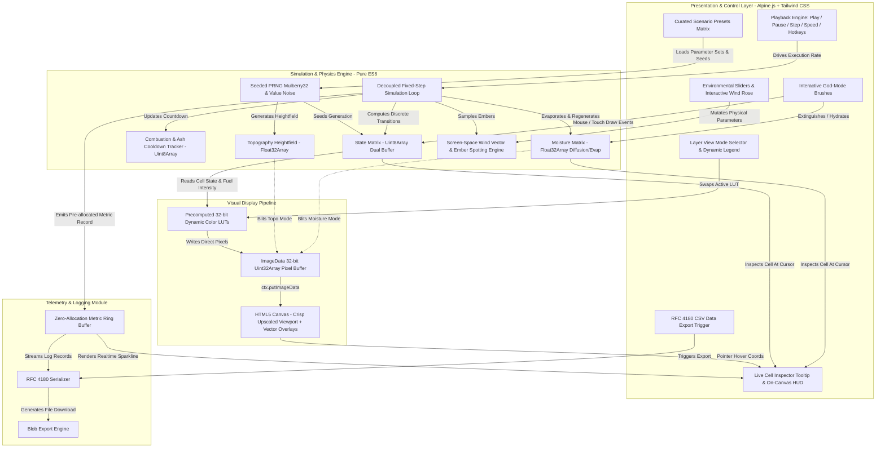
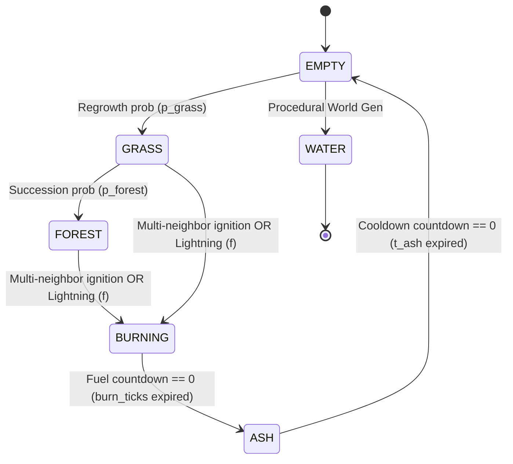
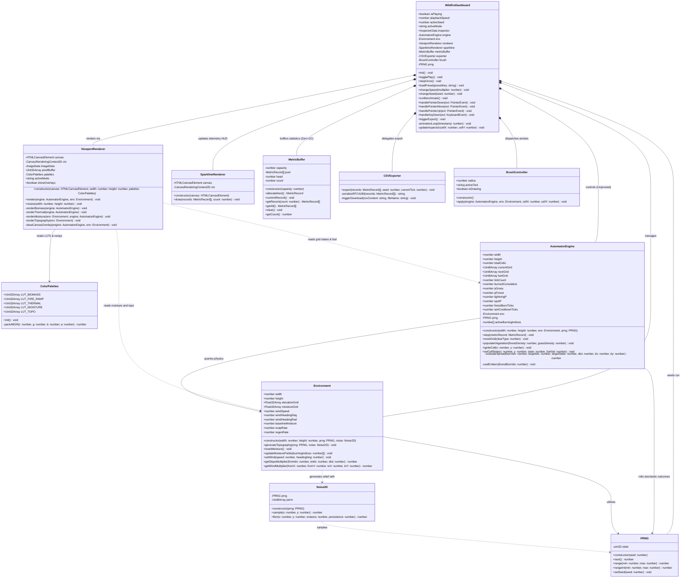
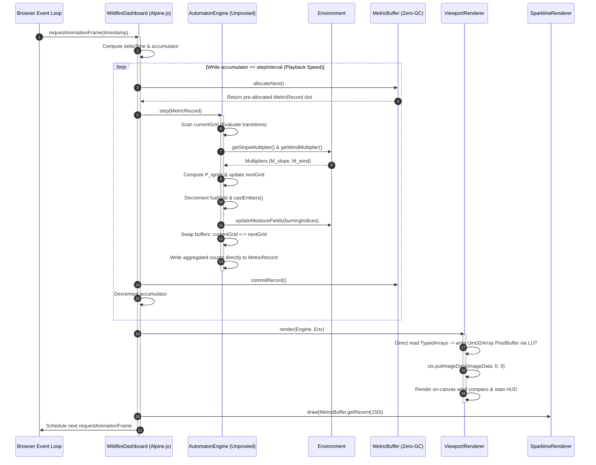
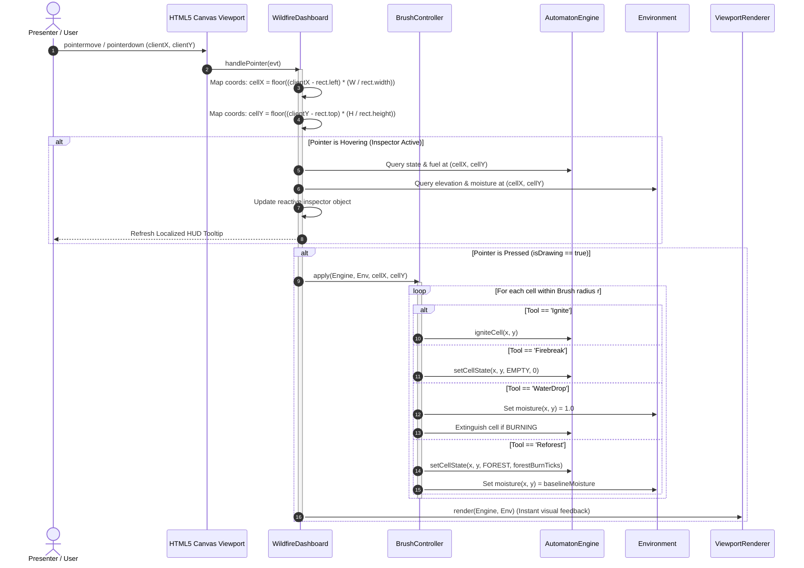
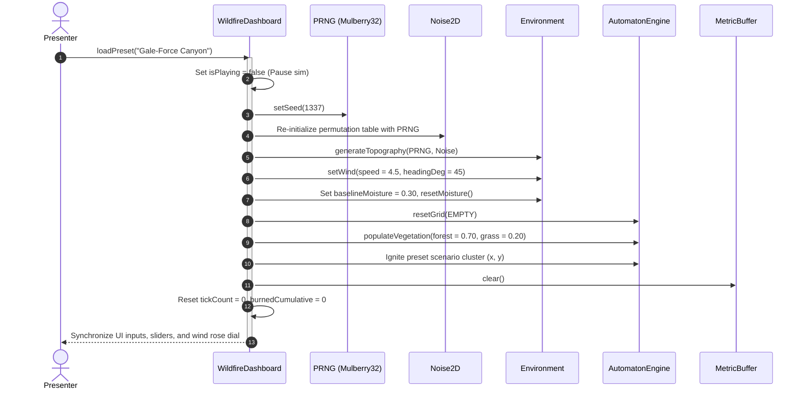

# Software Requirements Specification (SRS) & Implementation Plan

## Project: Multi-Layer Wildfire Cellular Automaton (Extended Drossel-Schwabl Model)

---

## 1. System Overview & Architecture

The application is a high-performance, client-side, zero-dependency browser-based simulation of an extended Drossel-Schwabl wildfire cellular automaton. It models complex ecological dynamics and fire propagation using multi-layer cellular matrices (discrete vegetation/combustion state, fuel countdown, dynamic moisture field, procedural elevation heightfield, and directional wind vectors).

Designed for **maximum demonstration impact, visual clarity, and live technical presentation**, the application couples an optimized HTML5 Canvas render engine (direct 32-bit pixel buffer blitting via precomputed Look-Up Tables) with a clean, reactive dashboard (Alpine.js + Tailwind CSS via CDN), an interactive cell inspection HUD, and an in-memory telemetry module for instant CSV data science export.

The system is architected for **zero-friction execution and vibe-coding friendliness**: it runs completely out of a single self-contained `index.html` file without a local web server or build toolchain, completely bypassing browser CORS restrictions on the `file://` protocol.

### 1.1 Architecture Diagram



---

## 2. Functional Requirements (FR)

### 2.1 Core Cellular Automaton Engine (REQ-CORE)

* **REQ-CORE-01 (Grid Representation & Storage Architecture):**
  * The system MUST maintain a 2D discrete grid with configurable dimensions (default presentation resolution: $160 \times 100$ cells; high-resolution demo mode: $320 \times 200$).
  * Grid layers MUST be backed by flat 1D TypedArrays for contiguous memory locality, hardware cache alignment, and zero garbage collection overhead during tick loops:
    * `currentGrid` & `nextGrid`: `Uint8Array` storing discrete cell states.
    * `fuelGrid`: `Uint8Array` tracking active combustion duration or ash recovery cooldown.
    * `moistureGrid`: `Float32Array` storing localized moisture $\mu_{x,y} \in [0.0, 1.0]$.
    * `elevationGrid`: `Float32Array` storing procedural elevation $E_{x,y} \in [0.0, 1.0]$.
  * Double-buffering (`currentGrid` and `nextGrid`) MUST be utilized to prevent asynchronous evaluation bias.
  * Boundaries MUST utilize **absorbing (clamped) edge conditions** to prevent unphysical toroidal wrap-around artifacts in directional wind and elevation gradients. Edge cells ($x=0, x=W-1, y=0, y=H-1$) remain static non-combustible `WATER` or `EMPTY`.
* **REQ-CORE-02 (Discrete Cell States):**
  * Each cell MUST occupy one of the following primary discrete states:
    * `0: EMPTY` (bare ground, rocky soil, non-combustible fuel deficit)
    * `1: GRASS` (rapid pioneer regrowth, low fuel density, single-tick burn)
    * `2: FOREST` (mature climax vegetation, high fuel density, sustained multi-tick burn)
    * `3: BURNING` (active exothermic reaction front; radiates heat, consumes fuel, evaporates local moisture)
    * `4: ASH` (residual combustion byproduct; temporary organic barrier inhibiting regrowth)
    * `5: WATER` (static non-combustible natural barrier)
* **REQ-CORE-03 (State Transitions & Lifecycle):**



* **REQ-CORE-04 (Combustion Mechanics & Fuel Persistence):**
  * The `fuelGrid` acts as a dual-phase countdown counter depending on the active state:
    * Upon igniting to `BURNING`:
      * `GRASS`: `fuelGrid` is set to $1$ tick.
      * `FOREST`: `fuelGrid` is set to configurable duration (default: $4$ ticks; range $[2, 8]$).
    * While `BURNING`: `fuelGrid` decrements by $1$ per tick. When reaching $0$, the cell transitions to `ASH`.
    * Upon transitioning to `ASH`: `fuelGrid` is reset to an inert cooldown duration ($t_{\text{ash}} \in [5, 15]$ ticks).
    * While `ASH`: `fuelGrid` decrements by $1$ per tick. Cells in `ASH` cannot ignite or regrow. When reaching $0$, the cell reverts to `EMPTY`.

---

### 2.2 Environmental & Physical Layers (REQ-ENV)

* **REQ-ENV-01 (Deterministic Pseudo-Random Generation & Procedural Topography):**
  * The engine MUST integrate a lightweight 32-bit PRNG (Mulberry32) to ensure 100% reproducible demo runs and export verification.
  * The elevation layer $E_{x,y} \in [0.0, 1.0]$ MUST be procedurally initialized using a lightweight, multi-octave 2D value/bilinear gradient noise generator parameterized by the active seed.
* **REQ-ENV-02 (Continuous Dynamic Moisture Layer & Evaporative Loss):**
  * The moisture matrix stores $\mu_{x,y} \in [0.0, 1.0]$.
  * Moisture loss around active combustion fronts MUST scale with the density of burning neighbors $\mathcal{N}_{\text{burn}}(x,y)$:
    $$\mu_{x,y}^{(t+1)} = \max\left(0.0, \, \mu_{x,y}^{(t)} - \delta_{\text{evap}} \cdot |\mathcal{N}_{\text{burn}}(x,y)|\right), \quad \delta_{\text{evap}} \approx 0.05$$
  * Non-burning cells undergo ambient moisture recovery toward baseline equilibrium $\mu_{\text{baseline}}$:
    $$\mu_{x,y}^{(t+1)} = \mu_{x,y}^{(t)} + \delta_{\text{regen}} \cdot \left(\mu_{\text{baseline}} - \mu_{x,y}^{(t)}\right), \quad \delta_{\text{regen}} \approx 0.01$$
* **REQ-ENV-03 (Topography & Distance-Weighted Slope Factor):**
  * Fire spread from burning source cell $A$ to target cell $B$ MUST factor in the directional slope gradient normalized by spatial grid distance:
    $$\nabla E_{AB} = \frac{E_B - E_A}{d_{AB}}, \quad d_{AB} = \begin{cases} 1.0 & \text{orthogonal} \\ \sqrt{2} & \text{diagonal} \end{cases}$$
  * Slope multiplier $M_{\text{slope}}$ is formalized with sensitivity constant $k_s \approx 2.5$:
    $$M_{\text{slope}} = \operatorname{clamp}\left(\exp\left(k_s \cdot \nabla E_{AB}\right), \, 0.1, \, 3.5\right)$$
    where uphill spread ($\nabla E_{AB} > 0$) exponentially accelerates fire propagation and downhill spread ($\nabla E_{AB} < 0$) suppresses it.
* **REQ-ENV-04 (Screen-Space Anisotropic Wind Vector Mechanics):**
  * The environment maintains global wind heading $\theta \in [0^\circ, 359^\circ]$ and velocity $v \in [0.0, 5.0]$.
  * **Screen-Space Coordinate Convention:** Because HTML5 Canvas coordinates place $(0,0)$ at the top-left with $+y$ pointing downwards, directional calculations MUST strictly match screen space:
    * $\theta = 0^\circ \implies \text{Wind pushes East } (+x)$
    * $\theta = 90^\circ \implies \text{Wind pushes South } (+y)$
    * $\theta = 180^\circ \implies \text{Wind pushes West } (-x)$
    * $\theta = 270^\circ \implies \text{Wind pushes North } (-y)$
  * For target cell $B$ at relative spatial angle $\phi_{AB} = \operatorname{atan2}(y_B - y_A, \, x_B - x_A)$, the directional wind factor is:
    $$M_{\text{wind}} = \max\left(0.05, \, 1.0 + c_w \cdot v \cdot \cos\left(\theta_{\text{rad}} - \phi_{AB}\right)\right), \quad c_w \approx 0.45$$
* **REQ-ENV-05 (Unified Multi-Neighbor Ignition Probability):**
  * To prevent diamond/square grid artifacts, single-neighbor transmission $P_{\text{spread}}(A \to B)$ incorporates Euclidean distance weighting ($1 / d_{AB}$):
    $$P_{\text{spread}}(A \to B) = \operatorname{clamp}\left(\frac{1}{d_{AB}} \cdot P_{\text{fuel}}(B) \cdot M_{\text{wind}} \cdot M_{\text{slope}} \cdot (1.0 - \mu_B), \, 0.0, \, 1.0\right)$$
    where base flammability satisfies $P_{\text{fuel}}(\text{GRASS}) \approx 0.70 > P_{\text{fuel}}(\text{FOREST}) \approx 0.40$.
  * For target cell $B \in \{\text{GRASS}, \text{FOREST}\}$ exposed to active burning neighbors $\mathcal{N}_{\text{burn}}(B)$, total ignition probability follows the independent union formula:
    $$P_{\text{ignite}}(B) = 1.0 - \prod_{A \in \mathcal{N}_{\text{burn}}(B)} \left(1.0 - P_{\text{spread}}(A \to B)\right)$$
  * **Spontaneous Lightning ($f$):** Lightning strikes ONLY unignited combustible vegetation (`GRASS` or `FOREST`):
    $$P_{\text{total\_ignition}}(B) = P_{\text{ignite}}(B) + f - \left(P_{\text{ignite}}(B) \cdot f\right)$$
    Cell $B$ transitions to `BURNING` if $U < P_{\text{total\_ignition}}(B)$, where $U \sim \operatorname{Uniform}(0, 1)$.
* **REQ-ENV-06 (Long-Range Downwind Ember Spotting):**
  * When wind speed $v \ge 2.5$, mature burning `FOREST` cells have probability $P_{\text{spot}} \approx 0.015$ per tick to launch an airborne ember downwind.
  * Destination coordinates $(x_{\text{dest}}, y_{\text{dest}})$ are projected along $\theta_{\text{rad}}$ at distance $d \in [2, 7]$ with stochastic angular jitter ($\pm 15^\circ$).
  * Destination coordinates MUST be validated against grid boundaries. If target cell $(x_{\text{dest}}, y_{\text{dest}})$ is valid, combustible (`GRASS` or `FOREST`), and sufficiently dry ($\mu < 0.65$), it ignites immediately into `BURNING`.

---

### 2.3 Presentation Polish, UI Controls & Interactivity (REQ-UI)

* **REQ-UI-01 (Decoupled Simulation Playback Engine):**
  * The UI MUST decouple simulation stepping from rendering:
    * Controls: `Play / Pause`, `Step (1 Tick)`, and `Speed Multiplier` ($0.25\times, 0.5\times, 1.0\times, 2.0\times, 5.0\times, \text{Max}$).
    * Preserves fluid 60 FPS viewport rendering while allowing frame-by-frame analysis or accelerated multi-decade ecological succession.
* **REQ-UI-02 (Curated Demonstration Presets):**
  * The UI MUST provide instant one-click scenario presets with calibrated parameters:

| Preset Name | Seed | $v$ | $\theta$ | $p_{\text{grass}}$ | $p_{\text{forest}}$ | $f$ | $\mu_{\text{baseline}}$ | Demonstration Focus |
| :--- | :---: | :---: | :---: | :---: | :---: | :---: | :---: | :--- |
| **1. Self-Organized Criticality (SOC)** | `42` | 0.5 | $0^\circ$ | 0.025 | 0.008 | $1.5 \times 10^{-4}$ | 0.40 | Classic scale-invariant power-law fire clusters |
| **2. Gale-Force Canyon** | `1337` | 4.5 | $45^\circ$ | 0.010 | 0.005 | $5.0 \times 10^{-5}$ | 0.30 | Anisotropic fire runs, ember spotting & terrain channeling |
| **3. Catastrophic Drought** | `999` | 2.5 | $180^\circ$ | 0.005 | 0.002 | $2.0 \times 10^{-4}$ | 0.08 | Explosive runaway firestorm across parched biomass |
| **4. Tactical Defense** | `777` | 2.0 | $90^\circ$ | 0.008 | 0.004 | $0.0$ | 0.35 | Interactive firebreak bulldozer & water drop containment |

* **REQ-UI-03 (Multi-Layer Viewport Modes & Dynamic Legends):**
  * On-the-fly switchable render modes, complete with an embedded HUD colorbar/legend:
    * `Biomass View` (Default): Naturalistic vegetation palette. **Combustion fronts MUST render with dynamic thermal intensity** derived from remaining `fuelGrid` ticks (white-hot $\to$ incandescent orange $\to$ smoldering crimson), producing visually alive fire fronts.
    * `Thermal / Intensity View`: High-contrast blackbody radiation palette (Dark Charcoal $\to$ Crimson $\to$ Bright Yellow-White).
    * `Moisture Heatmap`: Visualizes arid evaporation scars ($\text{sand orange} \to \text{teal} \to \text{saturated deep blue}$).
    * `Topography Shading`: Analytical shaded-relief elevation map highlighting ridges, peaks, and drainage valleys.
* **REQ-UI-04 (Interactive God-Mode Brushes & Accurate Pointer Projection):**
  * Pointer drag interactions (`pointerdown`, `pointermove`, `pointerup`) with configurable radius ($r \in [1, 10]$):
    * `Ignite`: Forces combustible cells into `BURNING`.
    * `Firebreak Bulldozer`: Instantly clears cells to `EMPTY` and zeros fuel.
    * `Aerial Water Drop`: Saturates moisture ($\mu \leftarrow 1.0$) and extinguishes burning cells.
    * `Reforest`: Restores mature `FOREST` with baseline moisture.
    * `Add Lake`: Carves permanent natural water reservoir (`WATER`), setting moisture to $1.0$ and depressing local elevation.
    * `Drain Lake`: Drains existing water reservoir cells (`WATER`) back to dry `EMPTY` ground, restoring baseline moisture and solid land elevation.
  * Canvas coordinates MUST be accurately re-projected from CSS client space to discrete grid coordinates regardless of window resizing or display DPI:
    $$x_{\text{grid}} = \left\lfloor (e.\text{clientX} - \text{rect}.\text{left} - \text{borderLeft}) \cdot \frac{W_{\text{grid}}}{\text{clientWidth}} \right\rfloor, \quad y_{\text{grid}} = \left\lfloor (e.\text{clientY} - \text{rect}.\text{top} - \text{borderTop}) \cdot \frac{H_{\text{grid}}}{\text{clientHeight}} \right\rfloor$$
* **REQ-UI-05 (Live Cell-Inspector HUD, On-Canvas Overlay & Realtime Sparklines):**
  * Hovering the cursor over the canvas displays a localized inspector tooltip detailing: $(x, y)$, State, Elevation ($E$), Moisture ($\mu$), and Fuel Countdown.
  * A top-left canvas translucent HUD overlay renders key indicators formatted as `[Total number (Percentage%)]` inside fixed-width stationary cards:
    * `FPS`: Real-time animation frame rate.
    * `TICK`: Monotonic iteration counter.
    * `FIRES`: Active burning cells and current grid percentage: `activeFiresCount (firesPercent%)`.
    * `FOREST`: Forest biomass cell count and combustible percentage: `forestCount (forestPercent%)`.
    * `GRASS`: Grass pioneer vegetation cell count and combustible percentage: `grassCount (grassPercent%)`.
    * `ASH`: Post-combustion ash cooldown cells and combustible percentage: `ashCount (ashPercent%)`.
    * `MODE`: Currently active render view mode (`BIOMASS`, `THERMAL`, `MOISTURE`, `TOPO`).
  * A wide mini-canvas sparkline renders rolling trends of Active Burning Cells, Forest Canopy, Grass Pioneer, and Ash Cooldown over the trailing 150 ticks.
* **REQ-UI-06 (Interactive Wind Controller):**
  * An intuitive circular indicator/dial allowing direct click-and-drag manipulation of wind heading $\theta$ and speed magnitude $v$.
* **REQ-UI-07 (Presenter Keyboard Shortcuts):**
  * The application MUST provide direct keyboard shortcuts for fluid stage presentations:
    * `Space`: Toggle Play / Pause
    * `KeyS`: Single-step simulation (1 tick)
    * `KeyR`: Reset simulation to active preset
    * `Digit1` to `Digit4`: Switch viewport modes (Biomass, Thermal, Moisture, Topo)
    * `KeyB`: Cycle active god-mode brush
    * `KeyT`: Trigger rapid 1000-tick performance benchmark (displays engine TPS)

---

### 2.4 Telemetry, Logging & Data Science Export (REQ-LOG)

* **REQ-LOG-01 (Zero-Allocation In-Memory Telemetry Ring Buffer):**
  * Pre-allocated circular ring buffer (default capacity: 50,000 records, automatically dynamically doubling when exceeded) to eliminate dynamic array allocations and garbage collection pauses while ensuring every single tick is captured.
  * Continuous per-tick logging across all playback speeds.
* **REQ-LOG-02 (Telemetry Record Schema):**

| Column Name | Type | Description |
| :--- | :--- | :--- |
| `tick` | Integer | Simulation tick index ($t \ge 0$) |
| `timestamp_ms` | Integer | Client wall-clock epoch timestamp |
| `seed` | Integer | Active simulation PRNG seed |
| `count_empty` | Integer | Barren / cleared cell count |
| `count_grass` | Integer | Active grass pioneer vegetation count |
| `count_forest` | Integer | Mature forest vegetation count |
| `count_burning` | Integer | Active combustion front cell count |
| `count_ash` | Integer | Inert ash / cooldown cell count |
| `count_water` | Integer | Water barrier cell count |
| `mean_moisture` | Float | Global average terrain moisture ($0.0 - 1.0$) |
| `wind_speed` | Float | Wind magnitude at tick $t$ |
| `wind_heading` | Integer | Wind direction in degrees ($0^\circ - 359^\circ$) |
| `burned_cumulative` | Integer | Monotonically increasing count of consumed cells |

* **REQ-LOG-03 (CSV Serialization & Blob Downloader):**
  * Export serializes records into RFC 4180-compliant CSV and triggers an immediate browser download via `URL.createObjectURL(new Blob([...], { type: 'text/csv;charset=utf-8;' }))`.
  * Filename format: `wildfire_sim_seed_<SEED>_tick_<TICK>.csv`.

---

## 3. Non-Functional Requirements (NFR)

* **NFR-01 (Zero-Build, Pure Web Runtime & Single-File Deployability):**
  * The entire application MUST run by opening `index.html` directly via the `file://` protocol or any static HTTP server.
  * Zero Node.js, Webpack, Vite, or compilation dependencies. Alpine.js and Tailwind CSS are loaded directly via public CDNs.
  * All logic and styles reside in a single self-contained `index.html` file to facilitate rapid vibe-coding, sandbox previews, and frictionless portability.
* **NFR-02 (Frame Budget & Direct 32-Bit Pixel Blitting via Precomputed Dynamic LUTs):**
  * Must sustain steady $\ge 60$ FPS at $160 \times 100$ and $\ge 50$ FPS at $320 \times 200$ during heavy combustion fronts on standard hardware.
  * Rendering MUST write directly into an `ImageData` 32-bit pixel buffer (`Uint32Array` view) blitted via `ctx.putImageData()`, completely bypassing slow vector path operations (`ctx.fillRect()`).
  * Color selection MUST utilize precomputed 32-bit Look-Up Tables (`Uint32Array` LUTs in little-endian `0xAABBGGRR` byte order). Burning cells interpolate dynamically across a 4-tier flame ramp based on remaining fuel countdown.
  * The canvas MUST utilize CSS `image-rendering: pixelated;` (with vendor-prefixed cascades and `!important`) to maintain crisp, artifact-free nearest-neighbor scaling.
  * **Anti-Blurring & Layout Guarantee:** The `<canvas>` element MUST avoid `rounded`, `shadow-2xl`, and `transition-all` directly on its node, as GPU compositing and border-radius clipping textures force bilinear resampling. Auto-fit scaling is achieved via `w-full h-full max-w-full max-h-full object-contain` with `aspect-ratio: 16/10`, and high-zoom inspection is supported through an `overflow-auto custom-scrollbar` viewport wrapper.
* **NFR-03 (Modular Clean Architecture within Single-File Script Scope):**
  * Internal code organization MUST enforce strict separation of concerns into distinct logical namespaces or classes:
    * `PRNG`: Seeded Mulberry32 generator and 2D procedural value noise.
    * `Environment`: Elevation heightfield, dynamic moisture decay/recovery, and wind vectors.
    * `AutomatonEngine`: Dual-buffer TypedArrays, multi-neighbor spread rules, and tick loop.
    * `Telemetry`: Zero-allocation metrics ring buffer and RFC 4180 CSV serializer.
    * `UI / Dashboard`: Alpine.js reactive components, mode switching, and pointer brush handlers.
  * The `AutomatonEngine` instance MUST remain **unproxied** outside Alpine's reactive tracking tree to prevent Proxy trap performance penalties during simulation ticks.
* **NFR-04 (Responsive & Presentation-Optimized Layout):**
  * Optimized for standard 1080p projectors, high-DPI desktop screens, and tablet displays with clear visual contrast, prominent stats, and intuitive touch/pointer controls.

---

## 4. Implementation Plan

```mermaid
gantt
    title Implementation Roadmap
    dateFormat  X
    axisFormat  Phase %d
    section Core Infrastructure
    Phase 1 : Scaffold, Seeded Noise & Fast 32-Bit Dynamic Canvas Pipeline :p1, 0, 1
    section Automaton & Physics
    Phase 2 : Multi-State Dual-Buffer CA & Decoupled Playback Loop          :p2, after p1, 1
    Phase 3 : Physics Layers (Slope, Screen-Space Wind & Moisture)          :p3, after p2, 1
    section Presentation Polish
    Phase 4 : Presets Matrix, View Modes, HUD Overlays & Hotkeys            :p4, after p3, 1
    section Telemetry & Export
    Phase 5 : Zero-GC Ring Buffer, Sparkline HUD & CSV Exporter             :p5, after p4, 1
```

### Phase 1: Scaffold, Seeded Noise & Fast 32-Bit LUT Canvas Pipeline

1. Create `index.html` referencing Tailwind CSS and Alpine.js via CDN.
2. Structure layout: Main viewport canvas framed by a collapsible parameter sidebar, top playback bar, and bottom telemetry HUD.
3. Implement seeded `Mulberry32` PRNG and a compact 2D procedural value noise generator for terrain generation.
4. Set up an `ImageData` frame buffer blitting loop using a `Uint32Array` view mapped to HTML5 Canvas with `image-rendering: pixelated`.
5. Precompute static color Look-Up Tables (`Uint32Array` LUTs in `0xAABBGGRR` format) and the dynamic flame heat ramp.
6. **Verification Milestone:** Canvas renders procedurally generated seeded heightmaps at $\ge 60$ FPS with instant seed reloading and zero allocation overhead in the render loop.

### Phase 2: State Transitions & Decoupled Playback Loop

1. Define cell state constants (`EMPTY`, `GRASS`, `FOREST`, `BURNING`, `ASH`, `WATER`).
2. Implement dual-buffer typed arrays (`currentGrid`, `nextGrid`) and fuel countdown tracker (`fuelGrid`).
3. Implement absorbing boundary conditions (clamped borders fixed to non-combustible states).
4. Implement stochastic growth transitions ($p_{\text{grass}}$, $p_{\text{forest}}$), spontaneous lightning ($f$), and multi-tick fuel/ash exhaustion counters.
5. Implement the decoupled tick engine supporting Play, Pause, Step-Tick, and configurable tick multipliers ($0.25\times \dots 5.0\times$).
6. **Verification Milestone:** The grid exhibits stable cyclical Drossel-Schwabl forest growth, controllable step-by-step or fast-forwarded without visual stuttering.

### Phase 3: Physical Layers (Topography, Moisture & Screen-Space Wind)

1. Implement physical environment layers:
   * Procedural heightfield generation ($E_{x,y}$).
   * Continuous moisture layer ($\mu_{x,y}$) with neighbor-density evaporative decay around burning cells and ambient replenishment.
2. Implement anisotropic screen-space wind influence ($M_{\text{wind}}$ with screen-space angle projection) and distance-normalized slope factor ($M_{\text{slope}}$ with $k_s = 2.5$).
3. Implement the unified multi-neighbor union ignition probability formula $P_{\text{ignite}}(B)$ with Euclidean distance scaling ($1/d_{AB}$).
4. Implement downwind ember spotting mechanics ($P_{\text{spot}}$) with boundary checking.
5. **Verification Milestone:** Wildfires realistically trace terrain contours: surging uphill, spreading downwind into elongated burn scars with natural rounded wavefronts, and halting at wet valleys or water bodies.

### Phase 4: Presets, Viewport Modes, On-Canvas HUD, Brushes & Hotkeys — ✅ Complete

1. Implement curated scenario presets matching the REQ-UI-02 parameter matrix.
2. Implement Viewport Color Modes with dynamic HUD legends: *Biomass* (with animated incandescent fire fronts), *Thermal/Intensity*, *Moisture Heatmap*, and *Topography Shading*.
3. Implement pointer coordinate re-projection with sub-pixel bounding box scaling, border-offset correction, and brush radius controls $[1, 10]$ (*Ignite*, *Firebreak*, *Water Drop*, *Reforest*, *Add Lake*, *Drain Lake*).
4. Implement stationary on-canvas overlays (stats banner and directional wind arrow) and keyboard shortcuts (REQ-UI-07).
5. Implement the live Cell Inspector tooltip displaying coordinates, state, moisture, and slope under the cursor.
6. **Verification Milestone:** Presenter activates "Tactical Defense", uses `Space` to pause, bulldozes a firebreak, carves or drains a lake barrier, inspects local vegetation and moisture metrics, and resumes the sim to demonstrate fire containment.

### Phase 5: Telemetry Engine, Sparkline HUD & CSV Exporter — ✅ Complete

1. Implement pre-allocated in-memory circular ring buffer tracking state populations, cumulative burned cells, wind, and mean moisture without object allocation.
2. Implement a wide live mini-canvas HUD sparkline displaying a 150-tick rolling graph of Canopy Biomass, Active Fires, Pioneer Grass, and Ash Cooldown.
3. Implement the `exportToCSV()` RFC 4180 serializer and browser Blob download trigger.
4. Implement the quick 1000-tick performance benchmark mode (`KeyT`).
5. **Verification Milestone:** After running a complex scenario, clicking "Export CSV" immediately triggers a valid, structured `.csv` download containing identical active seed data, validated for direct import into Excel, R, or Python/Pandas.

---

## 5. Architectural Design, Component Model & Interactions

### 5.1 File & Module Organization

To satisfy **NFR-01** (zero-build, single-file deployability) while adhering to **NFR-03** (modular clean architecture), the codebase uses an encapsulated, namespace-isolated structure within `index.html` alongside a modular reference source structure in `src/`. All modular files use a universal UMD / browser-global pattern (`window.ModuleName = ModuleName; if (typeof module !== 'undefined') module.exports = { ... };`) ensuring flawless execution via `file://` with no build tools or bundlers.

```text
wildfire-ca/
│
├── index.html                   # Monolithic zero-dependency distribution (Production)
│
└── src/                         # Modular Source Architecture (Reference Architecture)
    ├── config/                  # Centralized configuration & constants
    │   ├── simConfig.js         # Physical constants, state enums, grid dimensions
    │   ├── presetsConfig.js     # Curated demonstration presets & scenarios
    │   └── renderConfig.js      # Color hex values, packed ABGR definitions
    ├── core/
    │   ├── PRNG.js              # Mulberry32 32-bit PRNG & Seed manager
    │   ├── Noise2D.js           # Multi-octave 2D procedural value noise generator
    │   ├── Environment.js       # Topography, continuous moisture, and screen-space wind model
    │   └── AutomatonEngine.js   # Dual-buffer TypedArray engine, tick loop & spread physics
    │
    ├── render/
    │   ├── ColorPalettes.js     # Precomputed 32-bit ABGR Look-Up Tables & dynamic fire ramps
    │   └── ViewportRenderer.js  # Direct Uint32Array ImageData blitter & on-canvas HUD overlays
    │
    ├── telemetry/
    │   ├── MetricBuffer.js      # Zero-allocation ring buffer for high-frequency metrics
    │   └── CSVExporter.js       # RFC 4180 compliant CSV stream builder & Blob downloader
    │
    ├── ui/
    │   ├── BrushController.js   # Precise coordinate re-projection & god-mode edits
    │   ├── WindRoseWidget.js    # Interactive polar coordinate wind controller
    │   ├── KeyboardBridge.js    # Presenter keyboard shortcut handler
    │   └── DashboardBridge.js   # Alpine.js reactive root store (isolated from core engine)
    │
    └── styles/
        └── custom.css           # CSS canvas pixelated rules, HUD typography & dial styles
```

#### Monolithic Script Packaging Topology (`index.html`)

```html
<!DOCTYPE html>
<html lang="en">
<head>
  <meta charset="UTF-8">
  <meta name="viewport" content="width=device-width, initial-scale=1.0">
  <title>Extended Drossel-Schwabl Wildfire Automaton</title>
  <!-- CDN Dependencies: Zero Build Required -->
  <script src="https://cdn.tailwindcss.com"></script>
  <script defer src="https://cdn.jsdelivr.net/npm/alpinejs@3.x.x/dist/cdn.min.js"></script>
  <style>
    canvas.pixelated { image-rendering: pixelated; image-rendering: crisp-edges; }
  </style>
</head>
<body class="bg-slate-950 text-slate-100 antialiased font-sans" x-data="wildfireApp()">
  <!-- UI Layout: Top Playback Bar, Canvas Viewport with On-Screen HUD, Collapsible Sidebar, Bottom Sparkline -->
  
  <script>
    // Module 1: Seeded PRNG & Procedural Value Noise
    // Module 2: Color Look-Up Tables (Uint32Array 0xAABBGGRR) & Flame Ramps
    // Module 3: Environment State (Heightfield, Moisture, Screen-Space Wind)
    // Module 4: Cellular Automaton Engine (Dual-Buffer TypedArrays, Zero GC)
    // Module 5: Viewport Renderer (Direct ImageData Blit & Canvas Overlays)
    // Module 6: Telemetry Pre-Allocated Ring Buffer & RFC 4180 CSV Serializer
    // Module 7: Alpine.js Reactive Component Controller (Engine Unproxied)
  </script>
</body>
</html>
```

---

### 5.2 Detailed Class Diagram



---

### 5.3 Detailed Component & Class Specifications

#### 5.3.1 PRNG & Procedural Noise Module

* **`PRNG` (Mulberry32 Engine):**
  * **Responsibilities:** Provides high-throughput, deterministic pseudo-random 32-bit integer and floating-point distributions based on a supplied uint32 seed.
  * **Key Methods:**
    * `next(): number`: Generates a uniform float in $[0.0, 1.0)$.
    * `range(min, max): number`: Scales uniform output to an arbitrary continuous interval.
    * `rangeInt(min, max): number`: Generates an integer in $[min, max]$.
* **`Noise2D` (Value/Bilinear Gradient Noise):**
  * **Responsibilities:** Generates coherent, smooth, deterministic spatial fields for topographic heightmaps without external library dependencies.
  * **Key Methods:**
    * `sample(x, y): number`: Computes continuous 2D value noise via spatial hash lookups and smoothstep interpolation.
    * `fbm(x, y, octaves, persistence): number`: Evaluates Fractal Brownian Motion summing multiple frequency octaves to simulate rugged mountain ridges and flat valleys.

#### 5.3.2 Environment Subsystem

* **`Environment`:**
  * **Responsibilities:** Encapsulates continuous spatial fields, dynamic resource renewal/depletion equations, and screen-space wind vectors.
  * **Internal State:**
    * `elevationGrid`: `Float32Array` of size $W \times H$, normalized $[0.0, 1.0]$.
    * `moistureGrid`: `Float32Array` of size $W \times H$, dynamic values $[0.0, 1.0]$.
    * `windSpeed`: Magnitude $v \in [0.0, 5.0]$.
    * `windHeadingDeg`: Direction in degrees $\theta \in [0^\circ, 359^\circ]$.
    * `windHeadingRad`: Angle in screen-space radians: $\theta_{\text{rad}} = \theta \cdot \frac{\pi}{180}$.
  * **Key Methods:**
    * `getSlopeMultiplier(fromIdx, toIdx, dist): number`: Computes $M_{\text{slope}} = \operatorname{clamp}(\exp(2.5 \cdot \nabla E), 0.1, 3.5)$.
    * `getWindMultiplier(fromX, fromY, toX, toY): number`: Calculates directional vector projection against wind heading in screen space: $M_{\text{wind}} = \max(0.05, 1.0 + 0.45 \cdot v \cdot \cos(\theta_{\text{rad}} - \operatorname{atan2}(toY - fromY, toX - fromX)))$.
    * `updateMoistureFields(burningIndices)`: Evaporates moisture proportionally to burning neighbor counts, then regenerates ambient non-burning cells toward equilibrium.

#### 5.3.3 Automaton Core Engine

* **`AutomatonEngine`:**
  * **Responsibilities:** Executes discrete cellular automaton state transitions, manages double-buffered state memory, enforces fuel countdowns, runs stochastic spread equations, and schedules downwind ember drops.
  * **Internal Memory Architecture:**
    * `currentGrid`: `Uint8Array` of size $W \times H$ (Active read buffer).
    * `nextGrid`: `Uint8Array` of size $W \times H$ (Write buffer).
    * `fuelGrid`: `Uint8Array` of size $W \times H$ (Burn/ash countdown buffer).
    * `activeBurningIndices`: Reusable `Int32Array` or pre-sized array for tracking active combustion fronts without reallocating each tick.
  * **Key Methods:**
    * `step(targetRecord)`: Executes a single discrete timestep over all non-boundary cells, swaps buffer pointers, decrements fuel/ash counters, applies ember spotting, and writes metrics directly into the pre-allocated telemetry record.
    * `evaluateSpread(...)`: Evaluates Euclidean-normalized multi-neighbor transmission probability across neighbors.
    * `castEmbers(forestBurnIdx)`: Calculates long-range downwind trajectory casting for spotting fires ahead of the main fire front, verifying boundary and fuel conditions.

#### 5.3.4 Viewport & Color Pipeline

* **`ColorPalettes`:**
  * **Responsibilities:** Precomputes static Look-Up Tables (`Uint32Array` in native Little-Endian `0xAABBGGRR` byte order) to allow $O(1)$ pixel color translation.
  * **Look-Up Tables & Dynamic Flame Ramps:**
    * `LUT_BIOMASS`: Maps states 0–5 directly to discrete packed colors (Empty: `#2c1b18`, Grass: `#84a93c`, Forest: `#1b4332`, Ash: `#4a4a4a`, Water: `#1d4ed8`).
    * `LUT_FIRE_RAMP`: 4-tier incandescent flame ramp indexed by fuel intensity (smoldering crimson $\to$ bright red $\to$ incandescent orange $\to$ white-hot).
    * `LUT_THERMAL`: 256-entry blackbody heat gradient.
    * `LUT_MOISTURE`: 256-entry gradient from arid desert sand (`#d97706`) to deep saturated aqua (`#0284c7`).
    * `LUT_TOPO`: 256-entry shaded relief gradient mapping elevation $[0.0, 1.0]$ to contour-shaded grayscale bands.
* **`ViewportRenderer`:**
  * **Responsibilities:** Performs direct memory transfers into canvas `ImageData` via a cached `Uint32Array` view, blits using `ctx.putImageData()`, and draws optional lightweight on-canvas overlays (wind compass and statistics banner).

#### 5.3.5 Telemetry & Data Science Export

* **`MetricBuffer` (Zero Garbage-Collection Ring Buffer):**
  * **Responsibilities:** Pre-allocates a fixed pool of 50,000 `MetricRecord` instances upon initialization (with seamless doubling expansion if long simulations exceed capacity). During tick execution, records are populated in-place without object allocation, eliminating GC pauses during presentations and guaranteeing continuous tick-by-tick logging.
* **`CSVExporter`:**
  * **Responsibilities:** Serializes ring buffer records into an RFC 4180-compliant string, creates a DOM Blob URL (`text/csv`), and programmatically triggers an automated file download named `wildfire_sim_seed_<SEED>_tick_<TICK>.csv`.

---

### 5.4 Sequence & Interaction Flows

#### 5.4.1 Decoupled Simulation Stepping & Viewport Blit Loop



#### 5.4.2 Interactive God-Mode Brush & Dynamic Inspector HUD



#### 5.4.3 Scenario Preset Loading & Re-initialization



#### 5.4.4 Real-time Telemetry Ingestion & RFC 4180 CSV Export

```mermaid
sequenceDiagram
    autonumber
    actor User as Data Scientist / Presenter
    participant Dashboard as WildfireDashboard
    participant Buffer as MetricBuffer
    participant Exporter as CSVExporter
    participant Browser as Browser File System

    User->>Dashboard: Click "Export Telemetry (CSV)"
    activate Dashboard
    Dashboard->>Buffer: getAll()
    Buffer-->>Dashboard: Return Array of populated MetricRecords (up to 5,000)

    Dashboard->>Exporter: export(records, activeSeed, currentTick)
    activate Exporter
    Exporter->>Exporter: Format RFC 4180 Header: tick,timestamp_ms,seed,count_empty,...
    
    loop For each MetricRecord
        Exporter->>Exporter: Serialize comma-separated values with CRLF
    end

    Exporter->>Exporter: Create Blob(content, { type: 'text/csv;charset=utf-8;' })
    Exporter->>Exporter: objectUrl = URL.createObjectURL(blob)
    Exporter->>Browser: Create temporary <a download="wildfire_sim_seed_...csv">
    Exporter->>Browser: Element.click() (Trigger native save dialog)
    Exporter->>Browser: URL.revokeObjectURL(objectUrl)
    deactivate Exporter

    Dashboard-->>User: Display export confirmation notification
    deactivate Dashboard
```

---

### 5.5 Memory Architecture & TypedArray Layout

To fulfill the strict 60 FPS rendering budget (**NFR-02**) and eliminate GC pauses, the application stores spatial data in contiguous 1D typed arrays. Two-dimensional grid coordinates $(x, y)$ map to a 1D linear array offset $i$ via the row-major transformation:

$$i = y \cdot W + x, \quad x \in [0, W - 1], \, y \in [0, H - 1]$$

```text
Row-Major Linear Offset:
(0,0)  (1,0)  (2,0)  ... (W-1,0)
  |      |      |           |
 [0]    [1]    [2]   ...  [W-1]  -> Next row begins at index [W]
```

```text
Pixel Buffer Bitwise Layout (32-bit Little-Endian 0xAABBGGRR):
 31             24 23             16 15              8 7               0
+-----------------+-----------------+-----------------+-----------------+
|   Alpha (0xFF)  |    Blue (0xBB)  |   Green (0xGG)  |    Red (0xRR)   |
+-----------------+-----------------+-----------------+-----------------+
```

#### Memory Buffer Specifications

| Buffer Name | JavaScript Type | Element Size | Logical Values | Dynamic Mutability |
| :--- | :--- | :--- | :--- | :--- |
| `currentGrid` | `Uint8Array` | 1 Byte | $0 \dots 5$ (Discrete Cell States) | Swapped each tick |
| `nextGrid` | `Uint8Array` | 1 Byte | $0 \dots 5$ (Next State Evaluated) | Written each tick |
| `fuelGrid` | `Uint8Array` | 1 Byte | $0 \dots 255$ (Combustion / Ash Countdown) | Decremented per tick |
| `moistureGrid` | `Float32Array` | 4 Bytes | $0.0 \dots 1.0$ (Continuous Local Moisture) | Updated dynamically |
| `elevationGrid` | `Float32Array` | 4 Bytes | $0.0 \dots 1.0$ (Procedural Elevation) | Static (per scenario) |
| `pixelBuffer` | `Uint32Array` | 4 Bytes | Direct `0xAABBGGRR` Packed Colors | Overwritten on render |

At default demo dimensions ($160 \times 100 = 16,000$ cells), the entire active simulation state consumes under $300\text{ KB}$ of RAM, fitting comfortably within CPU L2 cache.

---

### 5.6 Reactive State Bridge (Alpine.js & Core Engine)

High-frequency TypedArray mutations are strictly decoupled from Alpine.js reactivity to prevent JavaScript Proxy trapping overhead during tick processing:

```mermaid
graph LR
    subgraph Alpine_Context [Alpine.js Reactive Scope (60 Hz UI Loop)]
        UIState[UI Reactivity: Play/Pause, Sliders, Preset Keys, Active View]
        InspectorState[Inspector Hover Tooltip & Sparkline Data]
    end

    subgraph Native_Memory [Unproxied High-Performance Engine Scope]
        EngineRef[AutomatonEngine & Environment]
        TypedMemory[Uint8Array & Float32Array Memory Buffers]
        LUTs[Precomputed 32-bit Color LUTs & Flame Ramps]
    end

    UIState -->|Dispatches Parameter Mutations| EngineRef
    EngineRef -->|Direct Writes at 60-120+ Ticks/sec| TypedMemory
    TypedMemory -->|Blits Direct Memory via LUT| LUTs
    EngineRef -.->|Emits Sampled Low-Frequency Telemetry (1-5 Ticks)| InspectorState
```

1. **Unproxied Model Access:** The instance of `AutomatonEngine` is stored as an unproxied internal variable on the Alpine component (`this.engine = new AutomatonEngine(...)`).
2. **One-Way UI Dispatch:** UI controls (such as wind sliders or playback toggles) directly mutate raw scalar properties on the engine (`this.engine.env.setWind(...)`).
3. **Throttled Telemetry Sampling:** Only summary metric snapshots (`TickMetric`) cross the boundary into Alpine's reactive scope at user-configured logging intervals, preventing unnecessary DOM recalculations during simulation runs.
